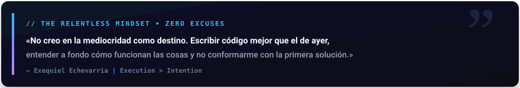
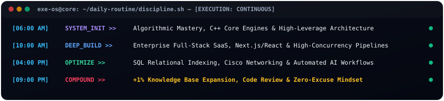

<div align="center">

  

  <br/><br/>

  <!-- Quick Action Badges -->
  <a href="https://cvechevarria.vercel.app" target="_blank">
    
  </a>
  <a href="./Exequiel_Echevarria_CV_ES.pdf" target="_blank">
    
  </a>
  <a href="./Exequiel_Echevarria_CV_EN.pdf" target="_blank">
    
  </a>
  <a href="https://www.linkedin.com/in/exequiel-echevarria/" target="_blank">
    
  </a>
  <a href="mailto:exemetal@hotmail.com">
    
  </a>

  <br/><br/>
  
  <p align="center">
    <b>Full Stack Engineer</b> • <b>Enterprise Systems Architect</b> • <b>Relentless Builder</b>
  </p>

  <sub>📍 Rosario, Santa Fe, Argentina • 🚀 Building high-concurrency software &amp; scalable infrastructure every single day.</sub>

</div>

<br/>


<br/>

## ⚡ The Manifesto // "Excelencia Como Estándar"

<div align="center">
  
</div>

<br/>

> **"No creo en la mediocridad como destino. Cada día trato de escribir código un poco mejor que el de ayer, entender un poco más a fondo por qué las cosas funcionan, y no conformarme con la primera solución que anda."**

Todavía tengo mucho para aprender. Lo que sí tengo claro es cómo encaro ese camino:

1. **Disciplina antes que motivación:** Los días de inspiración no alcanzan. Lo que me sostiene es la constancia, incluso cuando no tengo ganas.
2. **Ir a la raíz del problema:** Cuando algo me supera, no lo evito — lo desarmo en partes más chicas hasta entenderlo, aunque me lleve tiempo.
3. **Cuidar lo que construyo:** Trato de que cada línea de código y cada decisión de arquitectura tenga sentido, no solo que "funcione".
4. **Un poco mejor cada día:** Si hoy sé lo mismo que ayer, siento que me quedé atrás. Prefiero aprender de a poco pero todos los días.

---

<br/>

## 🛠️ The Daily Execution OS

<div align="center">
  
</div>

---

<br/>

## 💎 Core Engineering Pillars & Specialties

<table>
  <tr>
    <td width="50%" valign="top">
      <h3>🌐 1. Full-Stack & Enterprise SaaS</h3>
      <ul>
        <li><b>Modern Frontend:</b> React 19, Next.js, TypeScript, Tailwind CSS, Framer Motion.</li>
        <li><b>Architecture:</b> RBAC granular (Role-Based Access Control), Multi-tenant ecosystems.</li>
        <li><b>Integrations:</b> PayPal, Mercado Pago, Stripe, Webhooks, Resend &amp; transactional email pipelines (&lt;1s latency).</li>
        <li><b>UX/UI Craftsmanship:</b> Micro-animations, responsive layout systems, dark/light dynamic theming.</li>
      </ul>
    </td>
    <td width="50%" valign="top">
      <h3>⚡ 2. Low-Level & High-Throughput Engines</h3>
      <ul>
        <li><b>Core Languages:</b> C++, Python (Data Processing &amp; Custom Engines).</li>
        <li><b>OwlEyeEngine:</b> Algorithmic optimization, memory management, batch automation.</li>
        <li><b>AI Pipeline Automation:</b> Reducción de más del 60% de sobrecarga operativa manual mediante pipelines con IA.</li>
        <li><b>Reliability:</b> Robust error boundaries, structured logging, continuous execution runtime.</li>
      </ul>
    </td>
  </tr>
  <tr>
    <td width="50%" valign="top">
      <h3>🧠 3. Relational Data Architecture</h3>
      <ul>
        <li><b>Engines:</b> PostgreSQL, MySQL, SQL Server.</li>
        <li><b>Engineering:</b> Modelado relacional avanzado, normalización vs. desnormalización estratégica.</li>
        <li><b>Optimization:</b> Query optimization, index strategies (B-Tree, GIN), execution plan analysis.</li>
        <li><b>Data Integrity:</b> ACID compliance, strict constraints, transactional safety.</li>
      </ul>
    </td>
    <td width="50%" valign="top">
      <h3>🌐 4. Infrastructure, Cloud & Networking</h3>
      <ul>
        <li><b>Networking:</b> Cisco Networking Academy Certified (Score: 86/100).</li>
        <li><b>Server Ops:</b> Linux Systems Administration, Shell scripting, reverse proxies.</li>
        <li><b>Telemetry & Insights:</b> Vercel Web Analytics, performance monitoring, real-time logging.</li>
        <li><b>CI/CD & Automation:</b> Automated headless browser PDF generation via Puppeteer.</li>
      </ul>
    </td>
  </tr>
</table>

---

<br/>

## 🧰 Arsenal & Tech Stack

<div align="center">

### Frontend & UI Ecosystem
<p>
  
  
  
  
  
  
  
</p>

### Backend, Low-Level & Core Systems
<p>
  
  
  
  
  
  
</p>

### Databases & Relational Modeling
<p>
  
  
  
  
</p>

### Cloud, Infra & Networking
<p>
  
  
  
  
  
</p>

</div>

---

<br/>

## 🚀 Featured Projects & Flagship Works

### 1. 💼 Interactive Dynamic CV & Automated PDF Generator Engine
> **Tech:** HTML5 Semantic, Modern CSS Custom Properties, Vanilla JS, Puppeteer Core, Vercel Analytics.
- ⚡ **Multi-theme Engine:** Dark/Light mode + 4 dynamic color accents (Sapphire, Emerald, Amethyst, Cyan).
- 🌐 **Instant Bilingual Toggle:** Full ES/EN content synchronization without page reloads.
- 📄 **Puppeteer Headless Automation:** Pixel-perfect A4 vector PDF generation in both languages with zero layout shifting.
- 📊 **Telemetry Ready:** Integrated with `@vercel/analytics` for live visitor tracking.

### 2. ⚡ OwlEyeEngine & AI Workflow Automation Suite
> **Tech:** C++, Python, AI Embeddings, Batch Processors.
- Engineered high-throughput batch and data stream processing engines in C++ and Python.
- Automated complex operational workflows using AI pipelines, cutting manual overhead by **>60%**.
- Highly resilient memory footprint and deterministic low-latency execution.

### 3. 🏢 Enterprise Logistics Traceability System
> **Tech:** Relational SQL, Real-time Dashboard, Data Modeling.
- Led the operational transformation and real-time inventory traceability pipeline.
- Eradicated critical stock data discrepancies and boosted supply chain throughput by **+35%**.

---

<br/>

## 📊 Live GitHub Telemetry & Stats

<div align="center">
  
  
</div>

<div align="center">
  <br/>
  
</div>

---

<br/>

## 💻 Local Setup & Development

### 1. Clone the repository
```bash
git clone https://github.com/ExeDevCentral/CV.git
cd CV
```

### 2. Install dependencies (Vercel Analytics & Puppeteer)
```bash
npm install
```

### 3. Start local development server
```bash
npm start
# Server available at http://localhost:3000
```

### 4. Generate Pixel-Perfect PDF versions (ES & EN)
```bash
npm run pdf
# Output files: Exequiel_Echevarria_CV_ES.pdf & Exequiel_Echevarria_CV_EN.pdf
```

### 5. Deploy with Vercel Analytics
```bash
# Vercel automatically detects the project and enables analytics tracking out-of-the-box!
vercel deploy --prod
```

---

<br/>

## 📬 Let's Build Something Monumental

<div align="center">
  
  <table style="border-collapse: collapse; border: none;">
    <tr>
      <td align="center" style="padding: 16px;">
        <a href="mailto:exemetal@hotmail.com">
          <br/>
          <sub>Direct Executive Inbox</sub>
        </a>
      </td>
      <td align="center" style="padding: 16px;">
        <a href="https://www.linkedin.com/in/exequiel-echevarria/" target="_blank">
          <br/>
          <sub>Professional Network</sub>
        </a>
      </td>
      <td align="center" style="padding: 16px;">
        <a href="https://github.com/ExeDevCentral" target="_blank">
          <br/>
          <sub>Source Code &amp; Repos</sub>
        </a>
      </td>
      <td align="center" style="padding: 16px;">
        <a href="tel:+543416874786">
          <br/>
          <sub>Direct Line</sub>
        </a>
      </td>
    </tr>
  </table>

  <br/>

  

  <p align="center">
    <sub>Crafted with extreme attention to detail &amp; relentless discipline • <b>Exequiel Echevarria © 2026</b></sub>
  </p>

</div>
